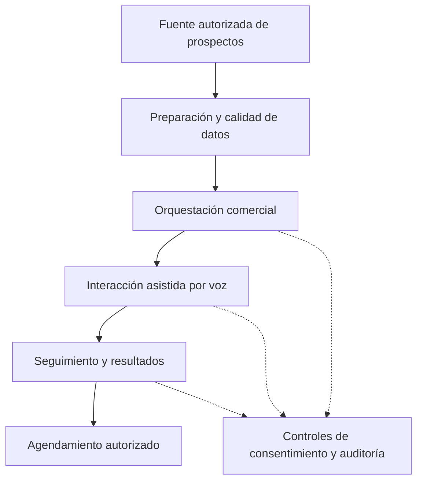

# Arquitectura pública (conceptual)

**No es un diagrama de implementación.** Se omitieron intencionalmente proveedores, endpoints, modelos, reglas de negocio, prompts, credenciales y protocolos internos.

## Principios

1. Separación entre interfaces, datos y operación.
2. Procesamiento limitado a contactos y datos con autorización aplicable.
3. Credenciales fuera del código y de la documentación pública.
4. Seguimiento auditable con acceso y retención definidos.
